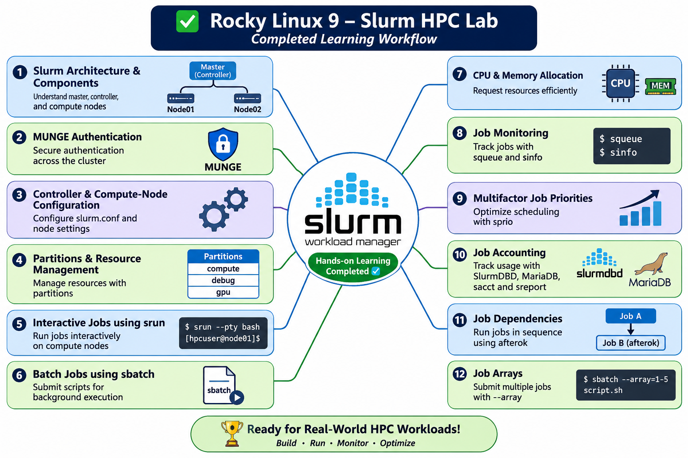

# Rocky Linux 9 – Slurm HPC Lab

A hands-on High Performance Computing (HPC) learning project using
Slurm Workload Manager on Rocky Linux 9.

## Lab Architecture

| Component | Hostname | IP |
|---|---|---|
| Controller | master | 192.168.232.20 |
| Compute Node | node01 | 192.168.232.21 |

## Environment

- Rocky Linux 9.8
- Slurm 22.05.11
- MUNGE authentication
- SlurmDBD
- MariaDB
- Partition: compute

## Topics Covered

1. Slurm architecture and components
2. MUNGE authentication
3. Slurm configuration
4. Partitions and nodes
5. Interactive jobs with srun
6. Batch jobs with sbatch
7. CPU and memory allocation
8. Job monitoring with squeue and sinfo
9. Multifactor job priorities
10. Accounting with SlurmDBD and MariaDB
11. Job dependencies
12. Job arrays

## Documentation

See [Slurm on Rocky Linux 9](docs/slurm-on-rocky-linux-9.md).

## Disclaimer

This is a practical learning lab. Review configurations and security
settings before using them in production.
